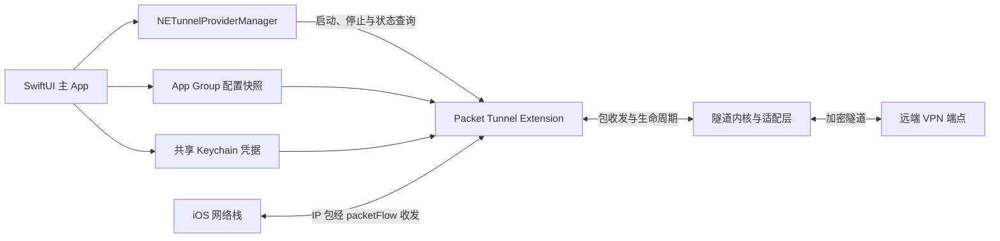

# LuckyClash iOS 技术方案与设计文档

2026 年 11 月 20 日 · 评审稿

## 1. 产品目标与首版范围

LuckyClash 是面向自带网络配置的用户的原生 iOS 客户端。目标是让用户导入受支持的 Clash YAML、选定远程节点、连接与断开，并能看懂失败原因。首版按 App Store VPN 应用规划，使用 SwiftUI 和 Network Extension。组织账号申请与真机开发并行。发布版是否集成 Clash 内核，以分发许可、实际包路由和真机稳定性为准。 [原始讨论《开发Clash客户端》](chatgpt-conversation://6affbe8a-8698-83ea-90f8-afe681b7a11a) · [Apple 审核指南 §5.4](https://developer.apple.com/app-store/review/guidelines/#vpn-apps)

| 首版范围 | 具体行为 |
| --- | --- |
| 导入配置 | 从「文件」或粘贴导入 YAML，显示支持的节点、字段级错误和可用预览。以版本化的字段和协议白名单定义兼容范围 |
| 连接体验 | 首页显示当前配置、节点与系统 VPN 状态。用户手动连接、断开，或选择节点后显式重连 |
| 流量模式 | 对纳入系统 VPN 路由的 IPv4、IPv6 和 DNS 流量，按已验证的远端隧道路径处理。应用界面说明系统路由例外和断开后的行为 |
| 数据管理 | 本地保存配置和最近选择，可删除配置。设置提供隐私政策和脱敏的本地诊断 |
| URL 导入与分流 | 从 HTTPS 链接导入 Clash YAML、base64 订阅或分享链接；显示订阅流量与到期，支持手动 / 自动更新；完整策略组、域名规则、GEOIP、RULE-SET 与 Fake-IP 由 Clash 内核执行 |
| 后续范围 | 自动选路、按需连接、macOS 和 visionOS |

首版以 iPhone 为发布验证重点。默认采用用户自备的远端节点，App 内无账号、代理销售、广告和分析 SDK。测试环境使用团队控制的短期测试配置。能否使用任意订阅、协议或服务器，取决于最终公布的兼容列表。

### 工程起点

现有项目使用 SwiftUI 和 SwiftData 模板。通过 `xcodebuild -list` 确认目前只有 LuckyClash、LuckyClashTests 和 LuckyClashUITests 三个目标。主目标同时声明 iOS、macOS 和 visionOS，iOS 部署目标为 27.2。首轮先确定开发真机可安装的系统版本，正式最低支持版本依据目标用户和依赖兼容性决定。SwiftData 可用于主 App 的配置元数据，现有 `Item` 与列表后续由配置页替换。 [工程定义](../LuckyClash.xcodeproj/project.xcproj) · [App 入口](../LuckyClash/LuckyClashApp.swift)

## 2. 核心选型与发布条件

| 路线 | 能验证什么 | 处置 |
| --- | --- | --- |
| SwiftUI + 标准远端 VPN 隧道 | 先隔离验证签名、系统授权、端到端包传输和网络恢复。可用 WireGuardKit 与受控服务器 | 作为基线原型。若改用它发布，只有经过验证的配置子集可宣称支持，且须明确接受产品范围变化 |
| SwiftUI + ProjectClash Clash 与 Clash-Adapter | 利用现有 Apple 构建与包适配验证 Clash YAML 和兼容节点，减少平台移植工作 | 作为 Clash 能力首选原型。以固定版本审查许可证、适配方式和真实网络路径，审批通过后进入分发构建 |
| SwiftUI + 自行适配 Mihomo | 对构建、桥接和升级节奏有更直接的控制 | 仅在现有 Apple 适配存在可修复的技术阻碍时重新估算。仍须解决上游许可和 iOS 路由约束 |
| Fork FlClash | 可参考成熟的配置管理交互，Fork 可复用 Flutter 代码 | 需要新增 iOS Packet Tunnel 适配并承担 GPL 义务。保留为产品参考 |

FlClash 的 Release 页面未见正式 iOS 构建。维护者在 #1682 将 iOS 支持的讨论指向 #1132，本次访问 #1132 返回 404，无法据此确认移植进度或排期。Flutter 可承载 iOS 界面，移植的关键工作集中在扩展生命周期、IP 包适配、签名与分发。 [FlClash Releases](https://github.com/chen08209/FlClash/releases) · [维护者回复](https://github.com/chen08209/FlClash/issues/1682) · [FlClash 许可证](https://github.com/chen08209/FlClash/blob/main/LICENSE)

ProjectClash 将 Apple SDK、Swift 适配层与客户端拆为独立仓库。原型固定 SDK tag、Adapter commit、Go 与 gomobile 版本，记录校验和与构建命令。按固定版本的说明核对 arm64 真机 slice、模拟器 slice 和链接选项。若直接链接其静态 SDK，按 README 配置 Do Not Embed 和 `libresolv`，优先只链接到 Extension。WireGuardKit 的候选构建也要锁定版本并检查其传递依赖。 [ProjectClash SDK](https://github.com/ProjectClash/Clash) · [Clash-Adapter](https://github.com/ProjectClash/Clash-Adapter) · [Clash-Client](https://github.com/ProjectClash/Clash-Client) · [WireGuard Apple 许可证](https://git.zx2c4.com/wireguard-apple/tree/COPYING)

**许可是分发决策。** ProjectClash 核心及适配层的许可证按锁定版本审查。清单应覆盖内核、绑定代码、Swift 适配、依赖及规则数据，记录修改、组合链接范围、通知、对应源码与构建材料，以及 App Store 分发条款与相应 GPL 条款能否同时满足。若希望闭源，发布构建须采用满足该模式的组件或取得相应授权。在核查完成前用内部真机原型评估，暂缓向外部测试者分发相关构建。 [ProjectClash 核心许可证](https://github.com/ProjectClash/Clash/blob/main/LICENSE) · [适配层许可证](https://github.com/ProjectClash/Clash-Adapter/blob/main/LICENSE) · [GPL-3.0 条文](https://www.gnu.org/licenses/gpl-3.0.html) · [Apple 开发者协议与条款](https://developer.apple.com/support/terms/)

[ProjectClash 内部原型](LuckyClash-Clash-Prototype.md) 记录了候选版本、复现步骤、验证范围和发布阻碍。

## 3. 架构与模块职责

| 模块 | 责任 |
| --- | --- |
| LuckyClash 主目标 | 配置导入、选择、隐私披露、错误反馈。通过 VPN 协调器串行管理系统配置和连接命令 |
| LuckyClashPacketTunnel 扩展目标 | 读取固定配置版本、启动内核、应用网络设置、处理 IP 包与链路变化、清理资源。以系统回调为生命周期边界 |
| 共享 Swift 模块 | 配置快照、状态与错误模型、IPC 编解码。与内核绑定及 SwiftUI 解耦 |
| 内核适配层 | 提供异步 `start(snapshot, packetIO)`、`stop()`、`status()`。输入是 IP 包及地址族，输出为远端返回的包。接口定义属于本项目，按所选 SDK 实现 |

主 App 退出后，数据面由扩展与远端维持。包收发使用有界队列，流量计数采用聚合值，避免每包跨进程调用和日志写入。使用公开 Network Extension API，并把桥接层纳入审核前检查，确认其没有依赖私有 selector、从 `packetFlow` 提取私有文件描述符或启用本地监听器。原始 IP 包需要由对应网络栈处理，SOCKS 端口接收的是代理连接协议。 [NETunnelProviderManager](https://developer.apple.com/documentation/networkextension/netunnelprovidermanager) · [NEPacketTunnelFlow](https://developer.apple.com/documentation/networkextension/nepackettunnelflow) · [TN3120](https://developer.apple.com/documentation/technotes/tn3120-expected-use-cases-for-network-extension-packet-tunnel-providers)

### 路由、DNS 与失效行为

- 标准隧道原型用受控远端验证 IPv4、IPv6、TCP、UDP、隧道内 DNS 与出站地址。测试需核对远端确实收到隧道包，并验证连接远端所用的传输不会被自己的隧道路由再次捕获。
- Clash 内核原型逐项记录入口、转发、远端终止与回包路径。即使应用能访问网络，也要判断实际数据路径是否符合 TN3120 对远端隧道的预期。普通远程代理出站的适用性需按具体架构评估。发布前将数据流与用途如实写入审核说明。
- 首版使用与远端隧道关联的 DNS 设置，验证双栈默认路由及 Apple 定义的系统例外。规则模式把 `IP-CIDR`、`IP-CIDR6` 与 `MATCH` 的 `DIRECT` / 代理策略转换为隧道的 `includedRoutes` 与 `excludedRoutes`；域名规则、过滤性 `REJECT`、Fake-IP、全系统 DNS 截获或本地监听配置仍按白名单提示不支持。其余特定目的地址的路由范围沿用系统 `includedRoutes` 方案并在真机验证。
- 连接后的意外断链进入有界重连，重连期间检查是否发生意外出站。无法恢复时停止扩展并明确提示系统可能恢复普通网络访问。计划阶段不承诺系统级断网保护。 [TN3120](https://developer.apple.com/documentation/technotes/tn3120-expected-use-cases-for-network-extension-packet-tunnel-providers) · [Apple VPN 路由文档](https://developer.apple.com/documentation/networkextension/routing-your-vpn-network-traffic)

## 4. 配置、连接与界面设计

### 配置存储与导入

| 数据 | 持久化与访问 |
| --- | --- |
| `Profile` | 主 App 私有数据库，保存 ID、名称、选中节点、当前修订号。首版可沿用 SwiftData |
| `TunnelSnapshot` | App Group 中的不可变版本文件，保存 schemaVersion、profileID、revision、端点、受限参数与凭据引用 |
| 凭据 | 共享 Keychain，供签名的 App 和 Extension 读取。依据锁屏和后台恢复要求验证访问级别，优先考虑首次解锁后可用的仅本机类别 |
| 系统配置 | `providerConfiguration` 只放稳定配置标识和快照版本。VPN 账号、密钥和原始配置文本不写入系统偏好 |
| 诊断 | 本地保留短期有界记录，仅包含事件、错误码和必要的时间信息。导出前预览，排除密钥、订阅链接、访问目标和包内容 |

导入顺序为读取 → 解析 → 白名单验证 → 预览 → 保存。设置文件大小、YAML 嵌套和节点数量上限，限制解析器自定义标签与别名展开。协议首选项由原型验证决定，首版至少验证一种可发布的加密远端数据路径。兼容矩阵覆盖支持字段、语义、错误提示及协议能力。用户应能定位未知字段、无效凭据引用和无法使用的节点。保存时先写凭据和暂存文件，再原子发布新快照，最后提交元数据指针。提交失败保留旧修订。清理过期版本前确认当前连接和系统配置均已释放引用。切换节点通过受控断开与重连应用新版本，配置保存成功和连接成功分别反馈。

### VPN 生命周期与进程通信

1. 首次使用先展示数据披露。用户确认后，加载已存在的 VPN 配置，按本 App 的 Provider Bundle ID 与稳定标识匹配。首次才创建。保存并重载系统偏好后发起连接。
2. 扩展读取指定快照和凭据，验证版本、准备内核、建立远程传输并设置隧道网络参数。确认收发路径就绪后回调启动成功。失败与停止统一撤销监听、任务、队列和连接资源。启动、超时与停止交错时，每个系统完成回调只调用一次。
3. 主 App 以 `NEVPNStatus` 为系统连接状态来源，重返前台重新同步。扩展可通过 `sendProviderMessage` / `handleAppMessage` 提供精简的就绪状态、聚合流量及错误码。消息包含版本和请求 ID，支持超时。消息不可达时保留系统状态，诊断显示「暂不可用」。
4. 状态显示「未配置、已断开、连接中、已连接、重连中、断开中」及具体错误。权限拒绝指向系统授权，配置错误指向配置页，远端不可达提示检查节点。快速连点、系统设置断开、启动超时和扩展重启均以最新系统状态收敛。

### 首版页面

- **连接**显示当前配置和节点、连接开关、系统状态与恢复操作。无配置时主操作为「导入配置」。
- **配置**支持导入预览、设为当前、删除和查看兼容提示。删除仍被活动隧道引用的配置前先要求断开。
- **设置**包含隐私政策、首次使用披露的回看入口、兼容说明与可预览的本地诊断导出。

## 5. 个人账号到组织账号

| 当前条件 | 办理路径 |
| --- | --- |
| 自己或合伙人有合格法人实体，且自己是创始人或联合创始人 | 由 Account Holder 申请将个人会员转为组织会员。准备法定名称、D‑U‑N‑S、地址及验证材料 |
| 学校或其他已有主体愿意正式发布 | 由有签署权限的人员通过该组织加入 Apple Developer Program 或使用现有组织团队，再邀请开发者。提前确认署名、知识产权、发布权限和长期维护责任 |
| 目前只有个人账号且没有合适主体 | 继续开发及真机验证。正式发布排期以法人、签署权限和组织团队确定为前提 |

查询组织现有 D‑U‑N‑S 编码，核对登记信息与法定实体名称，需要时申请并等待同步。按 Apple 流程准备组织网站、联系信息和签署授权证明。以高校发布时由高校履行组织授权。社团或项目品牌本身须具备经 Apple 验证的法律实体资格才能独立申请。 [会员转换](https://developer.apple.com/help/account/membership/updating-your-account-information/) · [组织注册要求](https://developer.apple.com/programs/enroll/) · [D‑U‑N‑S 官方说明](https://developer.apple.com/help/account/membership/D-U-N-S/)

原型先核对现有个人账号是否为付费 Apple Developer Program 团队，并检查主 App 和扩展的 provisioning profile 能否签入 `packet-tunnel-provider`、App Group 与 Keychain Sharing 所需能力。本地模拟器可验证 UI 和配置解析，真机负责隧道验收。组织团队确定后，在创建正式 App Store Connect 记录前确定两个 Bundle ID 和共享组 ID。若改用另一团队，确认标识是否可用或需更换，重新验证签名、共享容器、钥匙串和 VPN 配置。已有开发环境凭据通过重新导入测试配置恢复。 [iOS 能力表](https://developer.apple.com/help/account/reference/supported-capabilities-ios/) · [配置 Network Extension](https://developer.apple.com/documentation/xcode/configuring-network-extensions/) · [Apple App 转移与数据影响](https://developer.apple.com/help/app-store-connect/transfer-an-app/overview-of-app-transfer/)

## 6. App Store 提交与隐私

- **账号与用途。** 按 §5.4 由组织团队提交。审核备注说明用户如何导入、远端如何接入、系统 VPN 权限用途、DNS 与 IPv6 行为。准备能在审核期间使用的隔离测试配置和可达端点，并给出从首次启动到验证远端连通的步骤。 [审核指南 §2.1、§5.4](https://developer.apple.com/app-store/review/guidelines/) · [App Review](https://developer.apple.com/app-store/review/)
- **数据披露。** 在首次启用或使用服务前展示数据收集与用途说明。同步维护应用内隐私政策、App Store 隐私标签及适用的 Privacy Manifest。应用策略为连接配置与诊断留在本机，业务运营端不收集用户流量、目标和连接日志。描述用户自备端点的处理边界，以及审核测试端点的具体行为。按真实数据流和依赖审计结果填写标签，遵循 §5.4 的数据使用、出售与第三方披露限制。 [审核指南 §5.1、§5.4](https://developer.apple.com/app-store/review/guidelines/) · [App 隐私详情](https://developer.apple.com/app-store/app-privacy-details/) · [第三方 SDK 要求](https://developer.apple.com/support/third-party-SDK-requirements/)
- **销售地区。** 发布前逐区记录法律审查、许可与备案材料、责任方及有效期。要求 VPN 许可的地区在 App Review Notes 提供许可信息。中国大陆单独评估 VPN 相关许可及适用的 ICP 备案，确认前不纳入首发地区。首发名单待运营主体确定后批准。 [审核指南 §5.4](https://developer.apple.com/app-store/review/guidelines/#vpn-apps) · [App Store Connect 地区合规资料](https://developer.apple.com/help/app-store-connect/reference/app-information/app-and-compliance-information/)
- **构建与 Beta。** 按实际引入的加密协议回答出口合规问卷，必要时提交文档。完成许可审查与组织签名后先走内部 TestFlight，外测按 TestFlight Beta App Review 流程推进。提审前核验当期 SDK 要求、发行构建、隐私与地区材料。 [加密出口合规](https://developer.apple.com/help/app-store-connect/manage-app-information/determine-and-upload-app-encryption-documentation/) · [TestFlight 流程](https://developer.apple.com/help/app-store-connect/test-a-beta-version/testflight-overview/) · [提交要求](https://developer.apple.com/app-store/submitting/)

## 7. 实施顺序与验收

| 计划窗口 | 开发线 | 账号与发布线 | 阶段产出 |
| --- | --- | --- | --- |
| 第 1–2 周 | 建两个目标的签名配置，在 iPhone 上用受控远端打通标准隧道 | 确认运营主体、会员转换或加入团队路径，查 D‑U‑N‑S | 真机安装、授权、IPv4/IPv6 和 DNS 抓取记录，以及可复现的构建 |
| 第 3–4 周 | 固定 ProjectClash 候选版本，验证配置加载、收发和真实路由 | 确认开源或闭源目标，审查 GPL 分发与地区可行性 | 依赖清单、数据流、内存基线、首版兼容矩阵。明确是否继续 Clash 集成 |
| 第 5–7 周 | 完成配置导入、连接页、状态协调、隐私披露和脱敏诊断 | 准备组织签名、隐私政策及审核端点 | 用户能独立完成导入、授权、连接、断开和错误恢复 |
| 第 8–10 周 | 跑真机故障、长稳与双栈测试，修复阻断问题 | 核验签名、隐私标签、地区和出口合规，在组织团队内测 | Release 构建与验收记录 |
| 第 11–12 周 | 根据 Beta 与审核反馈修订 | 按需外测并提交 App Review，批准后手动发布 | 审核材料齐备并完成提交，实际上架时间随审核结果确定 |

以上以一名开发者、可用测试服务器及已落实的组织负责人为估算前提。账号验证和许可办理时间独立跟踪。

| 真机验收项 | 初始通过标准 |
| --- | --- |
| 连接和断开 | 在最低支持版本和最新正式版本真机分别完成 20 次连接与断开，无重复 VPN 配置、悬挂状态或扩展崩溃 |
| 网络正确性 | Wi‑Fi、蜂窝、双栈及 IPv6-only/NAT64 场景验证 TCP/UDP、DNS 和远端出站。对纳入隧道的测试流量，用受控观察点核验出口和 DNS。记录系统路由例外 |
| 恢复 | 各完成 10 次 Wi‑Fi／蜂窝切换，覆盖锁屏、主 App 被终止、服务端无响应及系统设置断开。网络恢复后目标 15 秒内恢复或给出明确失败状态，按原型实测校准 |
| 长稳与资源 | 在最低规格目标设备持续混合流量 2 小时，完成一轮锁屏过夜检查，无扩展被系统因资源终止、异常内存增长或无法重连。记录内存峰值、延迟与功耗基线 |
| 配置与数据 | 测试畸形 YAML、超限输入、错误密钥、失败更新、活动配置删除和旧快照升级。验证不会破坏现有可用配置，核查诊断和系统配置的敏感字段 |
| 审核复现 | 组织签名构建可用。独立测试者照审核备注完成导入、首次授权、远端连通和断开。发布候选无阻断缺陷 |

测试数据使用受控设备、账号和端点。源文件、固化构建版本与结果需要关联，便于判断问题出在 iOS、远端或内核升级。

## 8. 当前待决策项

| 决策 | 确定时点 | 影响 |
| --- | --- | --- |
| 运营主体与发布团队 | 第 1–2 周 | 组织转入方式、正式签名及责任归属 |
| 开源策略和 GPL 分发结论 | 第 3–4 周 | 决定是否将 ProjectClash 纳入发布构建 |
| 可接受的远端数据路径与协议子集 | 第 3–4 周 | 定义首版能真实支持的 Clash 配置。若标准 VPN 仅能覆盖部分需求，是否调整产品范围由产品负责人决定 |
| 正式最低 iOS 版本和销售地区 | 进入组织内测前 | 决定真机矩阵、商店可用性和所需地区材料 |

首个开发任务是新增 iOS Packet Tunnel Extension 并核对签名，在一台可用 iPhone 上复现「用户授权 → 连接受控远端 → 验证 TCP、UDP 和 DNS → 断开并恢复网络」。首个发布任务是确定谁能作为组织 Account Holder，同时核查 D‑U‑N‑S 和现有团队权限。
